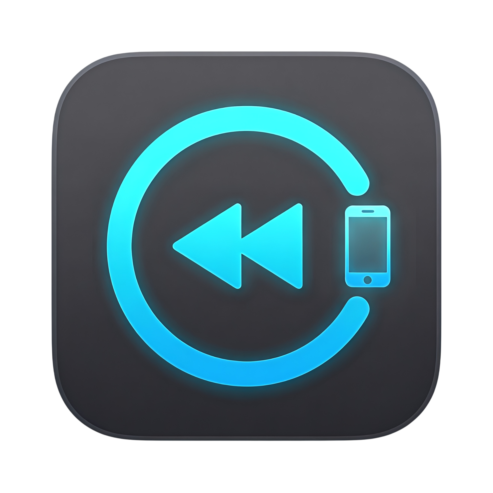

# ReplayCap Companion



ReplayCap Companion is a remote control for [ReplayCap](https://github.com/picccassso/ReplayMac) (also known as ReplayMac) that runs on your phone. Prop your phone up next to your keyboard and you can save a replay, start or stop the replay buffer, record a session or mute your audio without touching the Mac or remembering a hotkey.

The phone finds your Mac on the local network, asks ReplayMac for permission once, and then mirrors the Mac's Home page in real time. Both an Android app (Kotlin and Jetpack Compose) and an iOS app (Swift and SwiftUI) live in this repository, and they're kept at feature parity.

## Features

### Controls
- **Save replays**: Save the last N seconds of your replay buffer, or the longer extended replay when it's turned on in ReplayMac.
- **Replay buffer and sessions**: Start or stop the replay buffer, and record a full session that saves when you stop it.
- **Audio**: Mute or unmute the microphone and system audio.
- **Deck mode**: Keep the phone's screen on while it sits next to you, so the controls are always one tap away.

### Live status
- **Status card**: See whether the replay buffer or a session is running, how long it's been going and which display is being recorded, including when ReplayMac has fallen back to another display.
- **Buffer meters**: Watch the quick replay buffer fill up in memory and the extended replay fill up on disk, with a "Ready" mark once each is full.
- **This Session**: Every clip you save shows up on the phone with a thumbnail, its type, length, size and save time. Open one to reveal it in Finder or delete it from your Mac.

### Connecting
- **Automatic discovery**: Your Mac appears on its own when both devices are on the same Wi-Fi.
- **Remembers your Macs**: Previously connected Macs are listed with an online or offline indicator, and you can forget any of them.
- **Reconnects by itself**: When you reopen the app or the connection drops, it goes looking for your Mac again, even if the Mac's IP address has changed. Renaming your Mac or your phone in ReplayMac shows up on the phone straight away.
- **USB and manual entry**: Connect an Android phone over a USB cable with `adb reverse`, or type in an IP address and port.

### Design
- Dark, glass-style interface modelled on ReplayMac's Home window, with portrait and landscape layouts for phones and tablets.
- A short quick guide on first launch, which you can reopen from the question mark button at any time.

## Requirements

- **ReplayMac with the Companion server.** The server was added to ReplayMac after version 1.7.3 and hasn't shipped in a tagged release yet, so for now you need a build of ReplayMac from its `main` branch.
- **Android** 8.0 (API 26) or later.
- **iOS / iPadOS** 16 or later.
- Your phone and Mac on the same local network, or an Android phone plugged into the Mac by USB.

## Getting started

1. **Turn on the Companion server on your Mac.** Open ReplayMac's main window (click ReplayMac in the Dock), go to **Companion** in the sidebar and make sure the server is switched on. It's on by default and listens on port 7375.
2. **Open the companion on your phone.** Your Mac should appear under **On This Network** within a few seconds. Tap **Connect**.
3. **Allow the phone on your Mac.** ReplayMac asks whether to let the device connect. Click **Allow**. You only need to do this once per phone.

That's it. The phone switches to the Home screen and stays in sync with the Mac. Next time you open the app, it reconnects to the last Mac you used.

On iOS, the first launch also asks for permission to find devices on your local network. The app needs this to see your Mac, so tap **Allow**.

For USB connections, manual connections and everything on the Home screen, see the [user guide](docs/user-guide.md).

## Build from source

You'll need Android Studio or a JDK 17 install for Android, and Xcode 16 or later plus [XcodeGen](https://github.com/yonaskolb/XcodeGen) for iOS.

**Android**

```bash
cd android
./gradlew :app:assembleDebug
adb install -r app/build/outputs/apk/debug/app-debug.apk
```

**iOS**

```bash
cd ios
xcodegen generate
open ReplayCapCompanion.xcodeproj
```

Then pick the **ReplayCapCompanion** scheme and run it on a simulator or your device. The project is set up for automatic signing with the author's team, so you'll need to switch the team (and probably the bundle identifier) to your own under Signing & Capabilities.

Full build, test and release instructions are in [docs/building.md](docs/building.md).

## Documentation

- [User guide](docs/user-guide.md): connecting, pairing, the Home screen and troubleshooting.
- [Building and testing](docs/building.md): toolchains, build commands, tests and release builds for both platforms.
- [Architecture](docs/architecture.md): how each app is laid out and how data moves from the Mac to the screen.
- [Companion protocol](docs/protocol.md): discovery, pairing and every WebSocket message exchanged with ReplayMac.
- [Connection and reconnection](docs/connection.md): how the apps remember Macs and find them again.
- [Privacy and security](docs/privacy-and-security.md): permissions, what's stored on the phone and what goes over the network.

## Troubleshooting

**Your Mac doesn't show up?** Check that ReplayMac is open, the Companion server is switched on, and both devices are on the same Wi-Fi network. Guest networks and some office networks block devices from seeing each other. You can also type the Mac's IP address in **Enter Manually**; ReplayMac lists its addresses on the Companion page.

**Stuck on "Waiting for approval"?** ReplayMac is showing an "Allow device to connect?" dialog on your Mac. Click **Allow** there and the phone carries on by itself.

More fixes are in the [user guide](docs/user-guide.md#troubleshooting).

## Support

If you like ReplayMac and want to support its development, consider leaving a tip on [Ko-fi](https://ko-fi.com/picccassso). 🙂

## License

ReplayMac Companion is free and source-available.

You may download, use, inspect, build, and modify it for personal use. Redistributing builds, publishing renamed forks, commercial sales, and using ReplayMac or ReplayCap branding require permission.

See [LICENSE.md](LICENSE.md).
