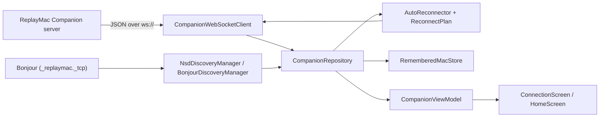

# Architecture

Both apps follow the same shape: a WebSocket client and a Bonjour browser at the bottom, a repository that owns all state in the middle, a view model, and then the screens. The class names match across platforms, so once you know one app you can find your way around the other.

## The layers

| Layer | What it does | Android | iOS |
| --- | --- | --- | --- |
| Socket | Opens `ws://host:port`, sends `hello`, keeps the connection alive, turns `auth_response` into a connection state, and passes every other message up as an event | `data/network/CompanionWebSocketClient.kt` (OkHttp) | `Network/CompanionWebSocketClient.swift` (`URLSessionWebSocketTask`) |
| Parsing | Reads the `type` field and decodes the matching message. Unknown types and bad JSON become their own events and never crash the app | `data/network/CompanionProtocolParser.kt` (kotlinx.serialization) | `Network/CompanionProtocolParser.swift` (`Codable`) |
| Discovery | Browses for `_replaymac._tcp`, resolves each Mac to an address and reads its server ID from the TXT record | `data/network/NsdDiscoveryManager.kt` (`NsdManager`) | `Network/BonjourDiscoveryManager.swift` (`NWBrowser` to browse, `NetService` to resolve) |
| Errors | Turns socket exceptions into plain sentences | `data/network/ConnectionErrors.kt` | `Network/ConnectionErrors.swift` |
| Repository | Owns the socket, discovery, the remembered Macs and the reconnector. Holds the latest snapshot and thumbnails, and saves settings | `data/repository/CompanionRepository.kt` | `Repository/CompanionRepository.swift` |
| Remembered Macs | Saves every Mac you've connected to, newest first | `data/repository/RememberedMacStore.kt` | `Repository/RememberedMacStore.swift` |
| Reconnection | Works out which addresses to try and keeps trying until the Mac turns up | `data/connection/ReconnectPlan.kt`, `AutoReconnector.kt` | `Connection/ReconnectPlan.swift`, `AutoReconnector.swift` |
| Demo mode | A pretend Mac in memory for trying the app without one. `DemoCompanionState` holds its rules; `DemoCompanionSession` runs its clock and speaks the same events as the socket | `data/demo/` | `Demo/` |
| View model | Passes repository state to the UI, works out the online/offline list, and holds UI-only state (selected clip, quick guide, manual entry fields) | `ui/viewmodel/CompanionViewModel.kt` | `ViewModels/CompanionViewModel.swift` |
| Screens | The connection screen, Home, the clip details sheet and the quick guide | `ui/screens/`, `ui/components/` | `UI/Screens/`, `UI/Components/` |

Android paths are relative to `android/app/src/main/java/com/replaymac/companion/`, and iOS paths to `ios/ReplayMacCompanion/`.

`HomeControls` (`HomeControls.kt` and `HomeControls.swift`) keeps UI concerns out of the logic. It takes a snapshot and returns the status card text and the six tiles with their titles, subtitles, tones and enabled states. Most of the tile behaviour is tested through it.

## From the Mac to the screen

1. The socket client receives a text frame and hands it to the parser.
2. If it's an `auth_challenge`, the client answers with `auth_proof`, an HMAC of the nonce keyed with the Mac's pairing secret (see [Companion protocol](protocol.md#pairing-and-sign-in)). On Android this logic lives in `data/network/CompanionSession.kt`; on iOS in `Network/CompanionWebSocketClient.swift` with `Security/PairingProof.swift`.
3. If it's an `auth_response`, the client updates its connection state straight away: `approved` becomes Connected, `pending` becomes Pending Approval, and `denied` becomes a failure flagged as a pairing denial.
4. Every message is then sent on as an event. The repository listens for these and:
   - replaces the snapshot on `state_snapshot` and `state_changed`, then asks for any missing thumbnails and drops ones for clips that have gone;
   - copies the timer and memory fields from `telemetry_tick` into the current snapshot;
   - stores the base64 image from `thumbnail_response`.
5. The repository also watches the connection state. A new connection gets saved to the remembered Macs. A pairing denial clears them. A connection that drops after working starts the reconnector.
6. The repository publishes a combined connection state. While the reconnector is searching and the socket hasn't settled, it reports **Reconnecting** with the Mac's name in place of the raw Connecting or Failed state.
6. The view model forwards everything to the UI. The app shows Home only when the state is Connected and the connection screen for everything else. Navigation stays flat, so the app simply swaps between the two.

Android uses `StateFlow` and `SharedFlow` on a `SupervisorJob() + Dispatchers.IO` scope in the repository, and Compose collects them with `collectAsState()`. iOS uses Combine subjects inside `@unchecked Sendable` classes protected by `NSLock`, and the `@MainActor` view model receives them on the main queue into `@Published` properties.

## From a tap to the Mac

A tile calls the view model (for example `saveReplay()`), the view model calls the repository, and the repository calls `sendAction` on the socket client with one of the six action names. The client encodes a `CompanionClientMessage` and sends it. The phone mirrors the Mac directly: it waits for the Mac's next `state_changed` and updates the display to match, ensuring the screen reflects what the Mac is actually doing.

Clip actions (`get_thumbnail`, `reveal_clip`, `delete_clip`) take the same route.

## Demo mode

**Try without a Mac** on the connection screen calls `startDemo()` on the repository. The repository talks to whichever `CompanionLink` is active: the socket client, or the demo session while the demo runs. Every command goes to that link, the demo's events go through the same handler as the socket's, and the repository reports the demo's Connected state, so Home and its sheets behave exactly as with a real Mac and no screen code branches on the demo. Only Home's **Demo mode** banner reads `isDemo`, so sample data can't pass for a real connection; its **Exit Demo** button and the power button both call `disconnect()`, which stops the demo.

The demo session ticks its timers once a second, plays saves out as `saving` → `saved` → `idle` with the new clip, answers thumbnail requests with drawn placeholders, and starts from the same sample data every time. Its clock and scheduler are injected, so the tests move time by hand.

The demo never touches the network: starting it stops discovery and the reconnector and closes the socket, and leaving it starts discovery again. Remembered Macs, pairing secrets and the last address are handled only from the socket's state, so the demo never reads or writes them.

## Stale sockets

Both socket clients keep a `generation` counter that goes up every time they connect. Callbacks from an older socket check the counter and step aside. This keeps a socket that's being replaced from reporting "Socket closed" or overwriting fresh state.

## Lifecycle

| Event | Android | iOS |
| --- | --- | --- |
| Launch | `CompanionApplication` creates the repository and takes a Wi-Fi multicast lock for discovery. The view model starts discovery | `ReplayCapCompanionApp` creates the repository and view model. The view model starts discovery |
| Comes to the foreground | `MainActivity.onStart` calls `onAppForegrounded()` | `UIApplication.willEnterForegroundNotification` calls `onAppForegrounded()` |
| Goes to the background | `MainActivity.onStop` calls `onAppBackgrounded()` | `UIApplication.didEnterBackgroundNotification` calls `onAppBackgrounded()` |

`onAppForegrounded()` sends a fresh `hello` if the phone is connected, which makes the Mac reply with a new snapshot. If the phone isn't connected, it starts looking for the last Mac.

`onAppBackgrounded()` stops the reconnector if it's searching. An open connection stays open, and discovery keeps running.

Deck mode uses `FLAG_KEEP_SCREEN_ON` on Android and `isIdleTimerDisabled` on iOS. The quick guide shows itself while `has_seen_onboarding` is false and sets it when dismissed.

On Android, the system Back gesture disconnects while Home is showing and no clip sheet is open.

## What's saved on the phone

Android keeps everything in one `SharedPreferences` file, `replaymac_companion_prefs`. iOS uses `UserDefaults.standard`. The key names are the same on both:

| Key | Holds |
| --- | --- |
| `device_id` | A random UUID created on first launch, sent in every `hello`. On iOS it lives in the Keychain instead |
| `last_host`, `last_port` | The last address you connected to (never the USB loopback), used to fill in Enter Manually |
| `keep_awake` | Deck mode on or off |
| `has_seen_onboarding` | Whether the quick guide has been dismissed |
| `remembered_macs_list` | The remembered Macs as a JSON array, newest first |
| `remembered_server_id`, `remembered_name`, `remembered_network_host`, `remembered_network_port`, `remembered_usb_port`, `remembered_last_used_usb` | The older single-Mac format. It's migrated into the list on first read and still mirrors the most recent Mac |

[Connection and reconnection](connection.md) explains how the remembered Macs are used.

The phone's name comes from `Build.MANUFACTURER` and `Build.MODEL` on Android (for example "Google Pixel 9 Pro") and `UIDevice.current.name` on iOS. From iOS 16, apps without a special entitlement get the generic model name ("iPhone" or "iPad"), so that's what the Mac sees first. You can rename the phone in ReplayMac's Paired Devices list and the new name shows up on the phone.

## Dependencies

Android uses Jetpack Compose with Material 3, AndroidX Activity and Lifecycle, kotlinx.coroutines, kotlinx.serialization and OkHttp. `org.json` handles the remembered Macs storage. Exact versions are in [building.md](building.md).

iOS builds on Apple frameworks only: SwiftUI, Combine, Foundation, UIKit and Network, which keeps the dependency list short and self-contained.

## Naming

The repository is called ReplayMac Companion. The app is called ReplayCap on iOS (Apple doesn't allow "Mac" in App Store names) and ReplayMac on Android, and some older names are still in the code:

| Where | Name |
| --- | --- |
| Android package and application ID | `com.replaymac.companion` |
| Android Gradle project | `ReplayMacCompanion` |
| Android launcher label | ReplayMac |
| iOS source folders | `ios/ReplayMacCompanion/`, `ios/ReplayMacCompanionTests/` |
| iOS project, target and Swift module | `ReplayCapCompanion` |
| iOS bundle ID and display name | `com.replaycap.companion`, ReplayCap |
| Bonjour service type | `_replaymac._tcp` |
